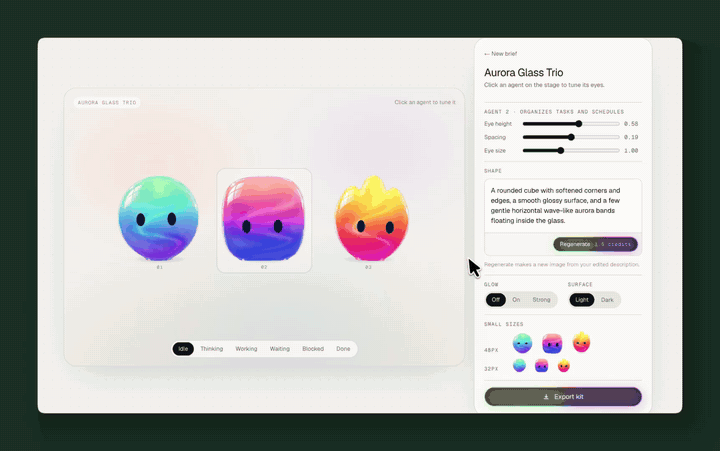
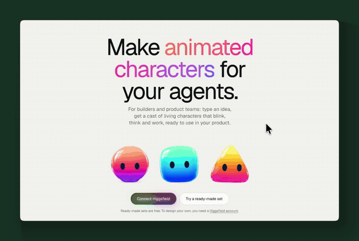
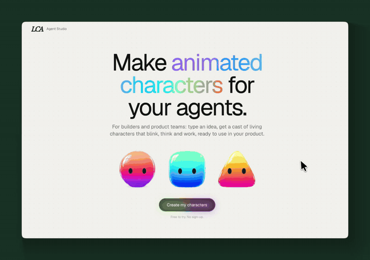
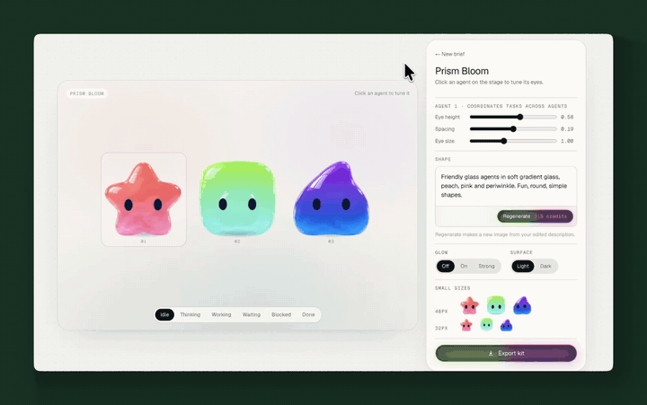
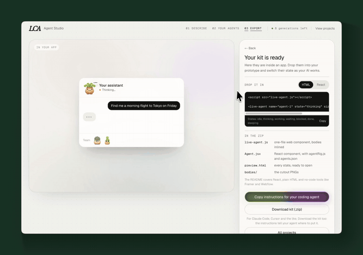
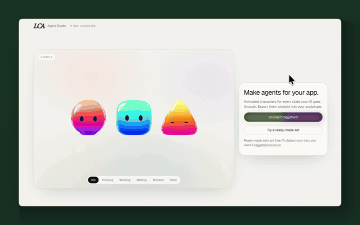

<p align="center">
  
</p>

<h1 align="center">Animated Agents</h1>

<p align="center">
  A free Claude skill that designs and animates mascots for your AI agents.<br>
  Describe them or drop in inspiration images. Get back characters that blink, hop and react to what your agent is doing.
</p>

<p align="center">
  <a href="https://github.com/latecheckout/lca-animated-agents/releases/latest/download/animated-agents.zip"><b>Download the skill (.zip)</b></a> ·
  <a href="#install">Install</a> ·
  <a href="#how-it-works">How it works</a> ·
  <a href="https://latecheckout.agency">Made by Late Checkout</a>
</p>

---

## What you get

Agents need a face. This skill gives each one a body, live eyes and seven working states:

| State | What it shows |
|---|---|
| **Idle** | Breathing, blinking, looking around |
| **Thinking** | Eyes drift up, thinking dots |
| **Working** | Focused, busy motion |
| **Waiting** | Patient, eyes on the user |
| **Blocked** | "!" badge, needs a hand |
| **Done** | A little hop and turn |
| **Sleeping** | Eyes closed, slow breathing |

You export a kit that drops straight into any app or prototype:

- `live-agent.js`: a one-file web component with the bodies built in
- `Agent.jsx`: a React component (`<Agent name="scout" state="working" />`)
- `agents.json`: per-agent face settings (eye position, size, colour)
- PNG bodies at 1024px and 512px, plus a `preview.html` with every state in light and dark

No video files. The bodies are PNGs, and the eyes and motion are drawn in code, so it's light, instant and easy to change.

<p align="center">
    <br>
  <sub>The three ready-made sets: flat, glass and plush</sub>
</p>

## Install

### Claude.ai (web or desktop)

1. [Download `animated-agents.zip`](https://github.com/latecheckout/lca-animated-agents/releases/latest/download/animated-agents.zip).
2. In Claude, go to **Settings → Capabilities**, make sure **Code execution** is on, then upload the zip under **Skills**.
3. *Optional:* connect **Higgsfield** in **Settings → Connectors** to generate your own characters. Without it you can still use the three ready-made sets for free.
4. Start a new chat and say: **"Make me some animated agents."**

<p align="center">
  
</p>

### Claude Code

```bash
git clone https://github.com/latecheckout/lca-animated-agents.git
cp -r lca-animated-agents/animated-agents ~/.claude/skills/
```

Then ask Claude Code to "make me some animated agents". Run `python scripts/check_setup.py` once to check Python dependencies.

## How it works

**1. Describe.** Write a line about your agents, or drop in up to five inspiration images. Pick a material (auto, glass, frosted, jelly, clay, plush, ceramic, flat) and how many agents (1 to 5). Or hit **Randomize**.

<p align="center">
  
</p>

**2. Generate.** Claude plans the cast, and every agent comes out as its own character from the same family: different shapes, top features and colours. Inspiration images become the style for the whole set, and you can ask for any number of agents however many images you add. Higgsfield renders the bodies on your own account, about 1.5 credits per agent.

**3. Tune.** Pick an eye style (Classic, Kawaii or Smiley, with mouths that move with the state), flip through every state and nudge the eyes, for the whole set or one agent. Add a glow and preview them on a light or dark background. Tell any agent what to change ("rounder", "more pink") and only that one regenerates.

<p align="center">
  
</p>

**4. Export.** See your agents working inside a sample app, then download the kit, or copy instructions for your coding agent (Claude Code, Cursor...) to add them for you.

<p align="center">
  
</p>

### No Higgsfield?

Pick a ready-made set (flat, glass or plush, three agents each), tune it and export it. Free.

<p align="center">
  
</p>

### Prefer to stay in the chat?

You can skip the studio page and run the whole thing conversationally, or bring your own character images and say "animate these". The best input is body-only art: no eyes or mouth, front-facing, plain background.

## Example prompts

- "Make me 3 glass agents for a travel booking assistant"
- "Here's our moodboard, design a cast of 4 agents from it"
- "Animate these" *(with your own character PNGs attached)*
- "Surprise me"
- "Recolour this set to match our brand palette"

## FAQ

**Does it cost anything?** The skill is free. Generating new characters uses your Higgsfield credits (about 1.5 per agent). The ready-made sets cost nothing.

**Can I use the output commercially?** Yes. The code is MIT licensed, and the characters you generate are yours, subject to Higgsfield's terms.

**3D?** It's 2D on purpose. Glossy materials (glass, frosted, jelly) give the 3D look while staying light.

**Something broke.** In the studio, click **Copy activity log** at the bottom of the page and paste it into Claude. If that doesn't sort it, [open an issue](https://github.com/latecheckout/lca-animated-agents/issues).

## What's inside

```
animated-agents/
├── SKILL.md          # instructions Claude follows
├── references/       # prompt, tuning and state guides
├── scripts/          # cutout, recolour, preview and packaging
└── assets/
    ├── studio/       # the Agent Studio page + ready-made sets
    └── template/     # agentRig.js engine and React component
```

---

<p align="center">
  Built by <a href="https://latecheckout.agency">Late Checkout</a>, a design studio for agentic experiences.<br>
  Made something? Tag <a href="https://x.com/meetLCA">@meetLCA</a>. We want to see it.
</p>

<p align="center"><sub>MIT License</sub></p>
